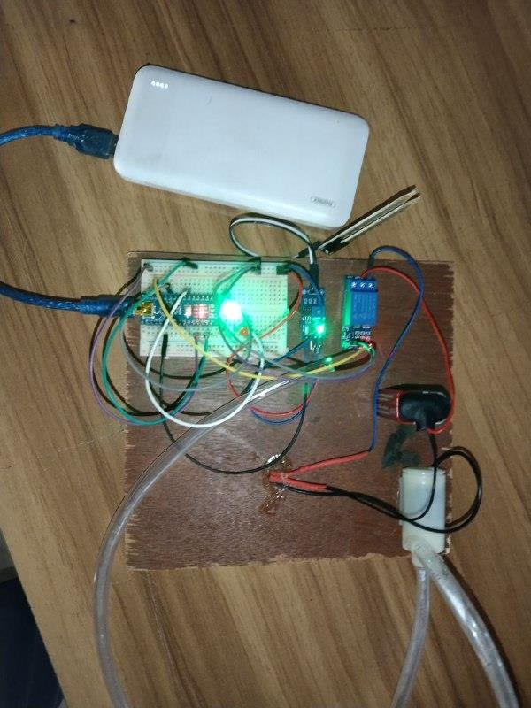
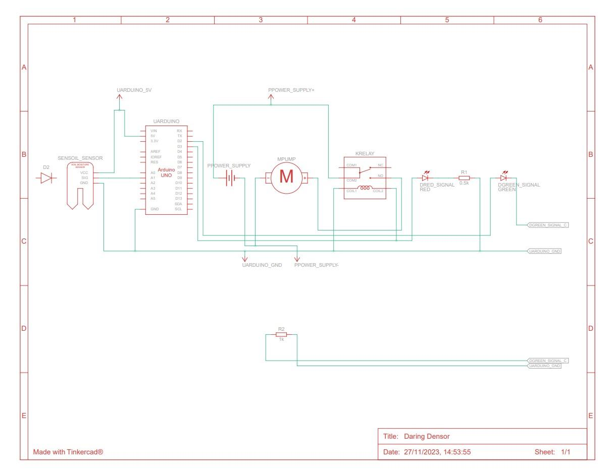

# Smart Garden Irrigation System

An Arduino-based automatic garden irrigation system that reads soil moisture and waters plants only when the soil is dry. Built as a Digital Electronics Lab project (CSE 224) at Daffodil International University.

## Overview

Manual garden watering is time-consuming and often leads to overwatering or underwatering, which harms plant growth and wastes water. This system automates the job: a soil moisture sensor continuously measures how wet the soil is, the Arduino decides whether watering is needed, and a relay-switched water pump delivers water only when the soil falls below a set moisture threshold.

The threshold can be changed in the code, so the same system can be tuned for plants that need different moisture levels.



## Features

- **Soil moisture sensing** — a soil moisture sensor provides real-time moisture data.
- **Arduino control** — the Arduino reads the sensor, applies the control logic, and drives the irrigation hardware.
- **Efficient water distribution** — a relay-switched water pump (with a solenoid valve, per the project design) waters only when needed, avoiding both scarcity and excess.
- **User-friendly interface** — LEDs give visual status indication.

## How It Works

1. The soil moisture sensor is placed in the soil and read on analog pin **A5**.
2. Every 10 ms, the Arduino reads the moisture value.
3. If the reading is **below 200** (dry soil), the outputs switch to start irrigation: A2 HIGH, A1 HIGH, A0 LOW.
4. If the reading is **200 or above** (wet enough), the outputs switch to stop irrigation: A0 HIGH, A1 LOW, A2 LOW.
5. The loop repeats every 10 ms (`delay(10)`), which keeps the Tinkercad simulation running smoothly.

## Components

| Component | Role |
|---|---|
| Arduino Nano (built system) / Arduino UNO (Tinkercad design) | Central microcontroller — reads the sensor and controls the irrigation system |
| Relay Module | Interfaces the Arduino with the high-power components (e.g. water pump) for safe, controlled switching |
| Soil Moisture Sensor | Real-time soil moisture monitoring |
| Water Pump | Controlled distribution of water to the plants |
| LED | Visual indication of system states |
| Breadboard | Prototyping board for building and testing the circuit |
| Jumper Wires | Connections between components on the breadboard |
| Resistors | Current management and component protection |
| Power Supply | Powers the Arduino and other components |

> The project design also mentions a solenoid valve for water distribution. It is listed as part of the system's features, but the report does not give its wiring or how it is driven — see [Notes & Limitations](#notes--limitations).

## Wiring



> The drawing labels the board "Arduino UNO"; the built system and the report's equipment list use the Arduino Nano.

The Tinkercad design file for this circuit is included in the repo as `Garden_Irrigation_System.brd` — open it in Tinkercad Circuits or Autodesk Eagle to view or edit the circuit.

Wiring as used by the code:

| Arduino Pin | Connected To |
|---|---|
| A5 (analog input) | Soil moisture sensor (signal) |
| A2 (output) | Output 2 |
| A1 (output) | Output 1 |
| A0 (output) | Output 0 |

A0, A1 and A2 are analog pins used as digital outputs. The relay module sits between the Arduino and the water pump, so the low-power Arduino can safely switch the pump. LEDs and resistors are used for status indication, and everything is prototyped on a breadboard with jumper wires.

> **Note on the code version:** the code in this repo is the Tinkercad version (sensor on A5, outputs on A0/A1/A2). The printed project report shows a different version of the sketch (sensor on A1, relays on D3/D7/D10, Serial output, 1-second loop). The repo follows the Tinkercad version.

## Code

The Arduino sketch from the Tinkercad design (also included in this repo as `SmartGardenIrrigation.ino`):

```cpp
// C++ code
//
int Moisture = 0;

void setup()
{
  pinMode(A5, INPUT);
  pinMode(A2, OUTPUT);
  pinMode(A1, OUTPUT);
  pinMode(A0, OUTPUT);
}

void loop()
{
  Moisture = analogRead(A5);
  if (Moisture < 200) {
    digitalWrite(A2, HIGH);
    digitalWrite(A1, HIGH);
    digitalWrite(A0, LOW);
  } else {
    digitalWrite(A0, HIGH);
    digitalWrite(A1, LOW);
    digitalWrite(A2, LOW);
  }
  delay(10); // Delay a little bit to improve simulation performance
}
```

### Code explanation

- **`int Moisture = 0;`** — stores the moisture reading from analog pin A5.
- **`pinMode(A5, INPUT);`** — configures A5 to read the sensor's analog value.
- **`pinMode(A2, OUTPUT);`, `pinMode(A1, OUTPUT);`, `pinMode(A0, OUTPUT);`** — configure the three analog pins as digital outputs to drive the relay and indicators.
- **`Moisture = analogRead(A5);`** — reads the current soil moisture level.
- **Threshold check (`Moisture < 200`)** — below 200 the system irrigates (A2 and A1 HIGH, A0 LOW); at or above 200 it stops (A0 HIGH, A1 and A2 LOW). The value 200 can be changed in the code for plants with different moisture needs.
- **`delay(10);`** — waits 10 ms between readings; the short delay keeps the Tinkercad simulation smooth. On real hardware a longer delay also works fine.

## Getting Started

1. Build the circuit on a breadboard as per the [Wiring](#wiring) table: moisture sensor to A5, outputs A0, A1 and A2, pump via the relay module, LEDs with resistors for status. (Or open `Garden_Irrigation_System.brd` in Tinkercad to see the design.)
2. Open the sketch in the Arduino IDE and select the Arduino board.
3. Upload the sketch to the board.
4. Place the moisture sensor in the soil and power the system.
5. To suit a different plant, change the threshold value `200` in the `if (Moisture < 200)` line and re-upload.

## Results & Discussion

The system was built and tested as a lab project. It successfully automates watering based on soil moisture, aiming for healthier plant growth and less wasted water. The report records no numerical test results (for example, measured water saved or moisture readings over time), so no quantitative claims are made here.

The report's own discussion notes two things to watch for:

- **Systematic error is possible** — check the setup and sensor readings carefully.
- **Loose connections can cause problems** — verify that every device is connected to the pin the code expects before running the system.

## Notes & Limitations

- **Output-to-device mapping is not specified in the report.** The code drives three outputs (A0, A1, A2) with mixed HIGH/LOW logic, but the report does not state which output controls the water pump and which drive the LEDs. Confirm the mapping on the physical build before use.
- **The solenoid valve** is mentioned in the project's feature list but does not appear in the equipment list, wiring, or code.
- **Manual control** is mentioned as an expected outcome (users being able to override the automatic system), but no manual-control code or switch is shown in the report.
- **Threshold 200** is given without calibration data — no moisture readings or per-plant values are recorded in the report.
- **Component details are not specified** — the report gives no sensor model, pump voltage/current, or power supply ratings.
- The **circuit diagram** (`circuit-diagram.png`) and the **photo of the built system** (`project-photo.jpg`) from the report are included in this repo and shown above.

## Project Details

- **Course:** Digital Electronics Lab (CSE 224), Daffodil International University
- **Submitted:** 29 November 2023
- **Submitted to:** Md. Assaduzzaman, Lecturer, Department of Computer Science and Engineering, Faculty of Science and Information Technology

### Team

| Member | ID | Role |
|---|---|---|
| Md. Shoadul Islam Niloy | 222-15-6208 | Leader |
| Tasnia Naima Nova | 222-15-6313 | Member |
| Afsana Afrin Esmita | 222-15-6244 | Member |
| Noushin Jahan Nishat | 222-15-6535 | Member |

## License

No license has been chosen for this project yet.
